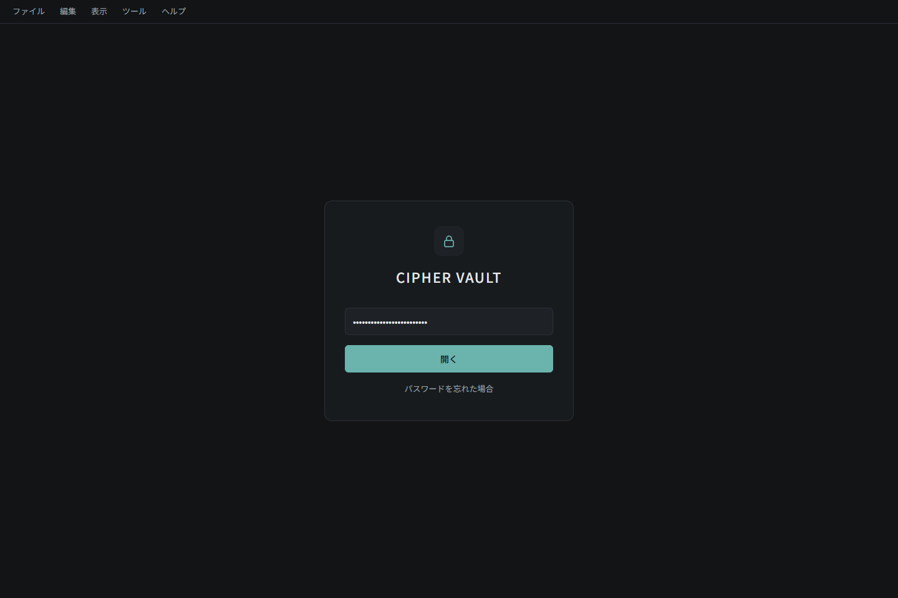
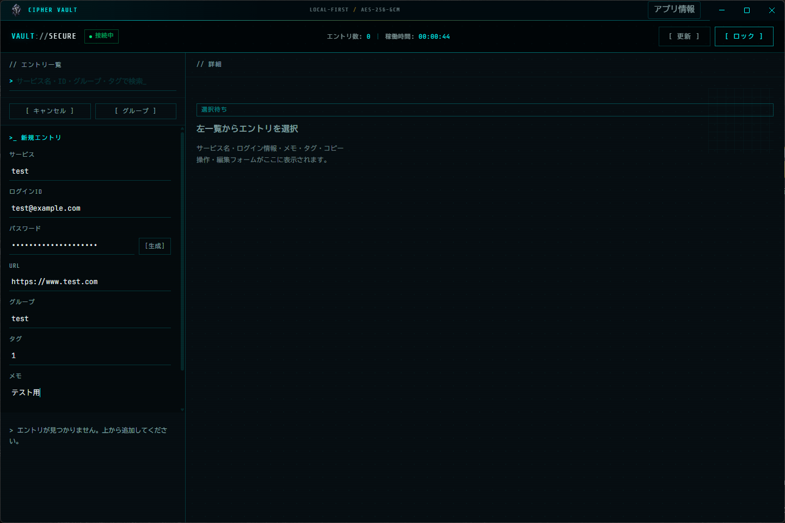
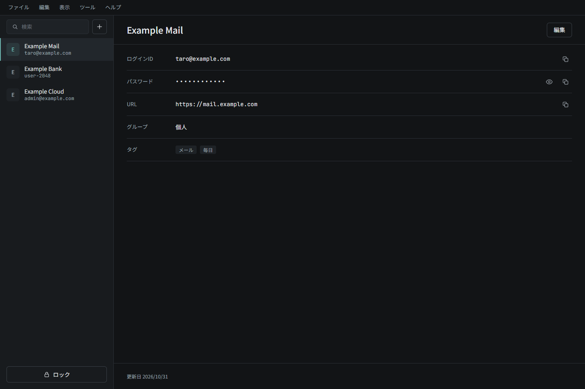

# CIPHER VAULT

端末内でパスワードを管理する、ローカルファーストのアプリです。Electronデスクトップ版とWeb/API版があり、保管庫データは自端末のSQLiteに保存します。

パスワードとメモはAES-256-GCMで暗号化します。サービス名・ログインID・URL・タグ・グループ・日時は、検索や一覧表示のため平文で保存します。保管庫データは外部へ送信しません。手動の更新確認・ダウンロード時にはGitHubに接続します。画面のフォントはライセンスとともに同梱し、外部通信なしで読み込みます。

## 入手・起動

Windows用の実行ファイルは [GitHub Releases](https://github.com/Termnix-IT/CIPHER-VAULT/releases) から入手します。配布版の利用にNode.jsやnpmのインストールは不要です。

| 配布形式 | 起動方法・用途 |
|---|---|
| `CIPHER-VAULT-<version>-x64-setup.exe` | インストールして利用する通常向けの版。アプリ内から手動更新できます |
| `CIPHER-VAULT-<version>-x64-portable.exe` | インストールせず実行する版。更新は配布ページから入手します |

どちらもデータはElectronの `userData/data/` に保存します。portable版もexeの隣にDBを保存する方式ではなく、exeを移動するだけでは保管庫データを移せません。別端末への移行には[暗号化バックアップ](#暗号化バックアップと復元)を使います。

ソースコードからの起動は[開発する場合](#開発する場合)を参照してください。

## 主な機能

- マスターキーによる保管庫の初期設定・ロック解除・ロック
- サービス名・ログインID・パスワード・URL・グループ・タグ・メモの登録、編集、削除
- サービス名・ログインID・グループ・タグの検索とグループ表示
- パスワード生成とログインID・パスワード・URLのコピー
- 共通サービス側で強制する、5分間操作がない場合の自動ロック
- 全項目を暗号化した `.cvault` バックアップと空の保管庫への復元（v0.2.2以降）
- 弱さ・使い回しなどを端末内で解析するセキュリティ監査（v0.2.2以降）
- setup版での手動アップデート

## 基本操作と画面

以下の画像はUI変更前のデスクトップ版です。登録画面の値はテスト用です。現在の画面は左に一覧、右に詳細を表示し、「編集する」で入力欄に切り替えます。バックアップとセキュリティ監査は「ツール」から開きます。

### 1. 保管庫を設定・解除する

初回起動時は、12文字以上のマスターキー（マスターパスワード）を入力し、「保管庫を初期化」を押します。次回以降は同じキーを入力し、「保管庫を解錠」を押します。

マスターキーは復元できません。忘れた場合の[完全リセット](#マスターキーを忘れた場合)では、保存済みデータが削除されます。



### 2. エントリを登録する

1. 左側の「新規追加」を押します。
2. 右側のフォームにサービス・ログインID・パスワードを入力します。URL・グループ・タグ・メモは任意です。タグはカンマで区切ります。
3. 「生成」を押すと、大文字・小文字・数字・記号を含む20文字のパスワードが入力されます。
4. 右下の「保存する」を押します。



### 3. 詳細を確認・編集する

左の一覧からエントリを選ぶと、右側に閲覧用の詳細を表示します。ログインID・パスワード・URLは各コピーボタンでクリップボードへコピーできます。パスワードは通常伏せ字で表示します。目のアイコンを3秒以内に2回クリックすると表示され、表示中は1回クリックで隠せます。キーボードでもアイコンを選択してEnterまたはSpaceを2回押すと表示できます。保存・生成・閲覧と編集の切り替え・エントリ切り替え・ロック時には伏せ字へ戻ります。

右上の「編集する」、または「編集」→「選択中のエントリを編集」で入力欄に切り替えます。値を変更して「保存する」を押すと更新し、閲覧に戻ります。「キャンセル」は未保存の変更があれば破棄を確認して閲覧に戻ります。グループ・タグ・メモも同じフォームで編集できます。「生成」は入力欄のパスワードを置き換えるため、保存前に内容を確認してください。削除は右上の「⋯」→「削除」から実行します。保存・キャンセルは右下に固定され、入力欄が収まらない場合は詳細部分をスクロールできます。



### 4. 検索・グループ表示・ロック

- 左上の検索欄で、サービス名・ログインID・グループ・タグを絞り込めます。
- 検索欄の上には登録件数を表示し、検索中は検索結果の件数と全件数を表示します。
- 検索欄の下の「すべて／グループ別」で表示を切り替え、グループ名で折りたたみます。
- 「ファイル」→「一覧を更新」でエントリ一覧を読み直します。アプリの更新は「ヘルプ」→「アプリ情報 / 更新」から行います。
- 作業を終えるときは左下の「保管庫をロック」、または「ファイル」→「保管庫をロック」を選びます。未保存の変更があれば破棄の確認を表示します。5分間操作がない場合も自動ロックされるため、入力中の内容は保存してください。Electron版はOSの画面ロック・スリープ・復帰通知でもロックし、保管庫の再解除が必要です。
- Electron版でコピーした内容は30秒後、または保管庫ロック時に自分のコピーと一致すれば消去します。後から別の内容をコピーした場合は保持します。OSの履歴や同期済みコピー、Web版は対象外です。[動作条件](docs/設計.md#electronのosイベントとクリップボード)を参照してください。

自動ロックは画面のタイマーではなく、保管庫を扱う共通サービス側で実行します。一覧の再取得や状態確認だけでは期限を延長しません。Electronはウィンドウを閉じた場合や画面プロセスが失われた場合もロックします。Webは状態確認で画面に反映し、接続状態を確認できない場合は表示中の秘密を消して再解除を求めます。

## 暗号化バックアップと復元

バックアップにはサービス名・ログインIDを含む全項目が暗号化されて入ります。マスターキーは含まれず、復元には書き出し時のバックアップ用パスフレーズが必要です。編集中の場合は保存してから「バックアップ」を開きます。

### 書き出す

1. 保管庫を解除し、「ツール」→「バックアップ / 復元」を選びます。
2. 専用パスフレーズ（12文字以上）と確認欄を入力します。
3. 「暗号化して書き出す」を押し、保存先に `.cvault` ファイルがあることを確認します。
4. ファイルとパスフレーズは別々の安全な場所に保管します。

### 復元する

1. 復元先でマスターキーを設定して保管庫を解除します。復元先はエントリ0件の保管庫に限ります。
2. 「ツール」→「バックアップ / 復元」を開き、`.cvault` ファイルを選択します。
3. パスフレーズ欄に書き出し時のパスフレーズを入力し、「選択したファイルを復元」を押します。
4. 復元したエントリを確認します。その後の解除には復元先のマスターキーを使います。

既存データへの追加・置き換えは行いません。バックアップは10,000件・暗号化前の内容11 MiB、読込ファイル16 MiBまで対応します。形式と互換性は[設計](docs/設計.md)を参照してください。

## セキュリティ監査

保存後に「ツール」→「セキュリティ監査」を開くと、弱い・重複・古いパスワード、URLなし、長期間更新なしを端末内で解析します。項目で絞り込み、「エントリを開く」から対象を編集できます。変更後は監査を開き直すか「再解析」を押します。

スコアは弱さと使い回しから算出する目安です。古さ・URLなし・長期間更新なしは減点しません。古さと長期間更新なしの目安は365日で、旧データのパスワード変更日は不明として扱います。外部の漏えい情報への照会は行わず、スコアは安全性を保証するものではありません。判定の詳細は[設計](docs/設計.md)を参照してください。

## アプリを更新する

Windowsのsetup版では「ヘルプ」→「アプリ情報 / 更新」から確認・ダウンロード・再起動して更新します。起動時の確認や通常終了時の自動適用はありません。portable版と開発モードでは配布ページを案内します。

更新機能のない旧版からは、アプリを終了して新しいsetupを同じインストール先へ上書きします。詳しくは[手動更新とアイコン](docs/手動更新とアイコン.md)を参照してください。

## マスターキーを忘れた場合

ロック画面の「マスターキーを忘れた場合」から、データ消失の確認と確認コードの手入力を経て完全リセットできます。**保存済みのエントリと保管庫設定はすべて削除されます。** マスターキーを復旧する操作ではありません。

事前に書き出した `.cvault` とそのパスフレーズがある場合は、新しいマスターキーを設定した空の保管庫へバックアップ時点の内容を復元できます。

## 開発する場合

開発にはNode.js 22.12.0以上とnpmを使用します。Windows用配布物の生成にはWindowsとPowerShellが必要です。Web/API版の開発はWindows・macOS・Linuxを対象としています。

リポジトリルートで実行します。

```powershell
npm install
npm run dev:desktop
```

| コマンド | 用途 |
|---|---|
| `npm run dev` | Web（`http://localhost:5173`）とAPI（`http://localhost:3001`）を起動 |
| `npm run dev:desktop` | ViteとElectronで開発起動 |
| `npm run build` / `npm run start` | Web/APIをビルドし、`http://localhost:3001` で起動 |
| `npm run build:desktop` / `npm run start:desktop` | デスクトップ版をビルド・起動 |
| `npm run test:api` | 一時DBでサービス・HTTP・Web配布の生成・固定導入を確認 |
| `npm run test:security` | Electronの画面URL・IPC送信元・sandbox preload・CSP・権限の境界を確認 |
| `npm run test:sessions` | 共通入力検証・KDF互換性・試行制御・OS連動・コピー期限を確認 |
| `npm run test:desktop-session` | 専用の一時保管庫でElectronの画面・IPC・失効を自動確認 |
| `npm run test:desktop-dev` | 一時ViteサーバーでElectron開発画面とHMR接続も確認 |
| `npm run test:web-policy` | 一時HTTPサーバーでWeb版のCSP・画面・API通信を確認 |
| `npm run test:updates` | 手動更新の制御確認 |
| `npm run package:desktop` | `dist-desktop/` にWindows用setup・portableを生成（公開しない） |
| `npm run package` | Node.jsで動かすWeb/API配布フォルダ `release/` を生成 |

ElectronはpreloadとIPCを経由して共通サービスを呼び出し、保管庫操作にHTTPサーバーを使いません。Web/APIのDBは既定で `apps/api/data/`、Electronは `userData/data/` に保存します。開発・テストでは利用中の保管庫を初期化・上書きしないでください。

Electronの画面はsandboxとcontextIsolationを有効にし、ブラウザの権限要求を拒否します。CSPと読み込み先の制限は、[設計](docs/設計.md#画面のsandboxとcsp)を参照してください。

個別起動、ネイティブ依存、保存先、配布手順は[開発・配布手順](docs/開発・配布手順.md)を参照してください。

CIはWindows・Node.js 24で上記の回帰・画面テストを実行します。本番依存のhigh以上と、全依存のlow以上の指摘を失敗条件にします。[CIと依存監査](docs/開発・配布手順.md#ciと依存監査)を参照してください。

## 関連ドキュメント

| 文書 | 内容 |
|---|---|
| [ドキュメント一覧](docs/README.md) | 文書の索引と公開・非公開の管理基準 |
| [設計](docs/設計.md) | アーキテクチャ、データ、暗号化、API |
| [開発・配布手順](docs/開発・配布手順.md) | 開発起動、ビルド、保存先、パッケージ化 |
| [手動更新とアイコン](docs/手動更新とアイコン.md) | 更新操作、旧版からの移行、アイコン生成 |
| [リリース手順](docs/リリース手順.md) | GitHub Releasesへの公開 |
| [リリースノート](docs/リリースノート/) | バージョンごとの変更内容と互換性 |
| [ワークフロー](docs/ワークフロー/) | 主要処理のMermaid図 |
