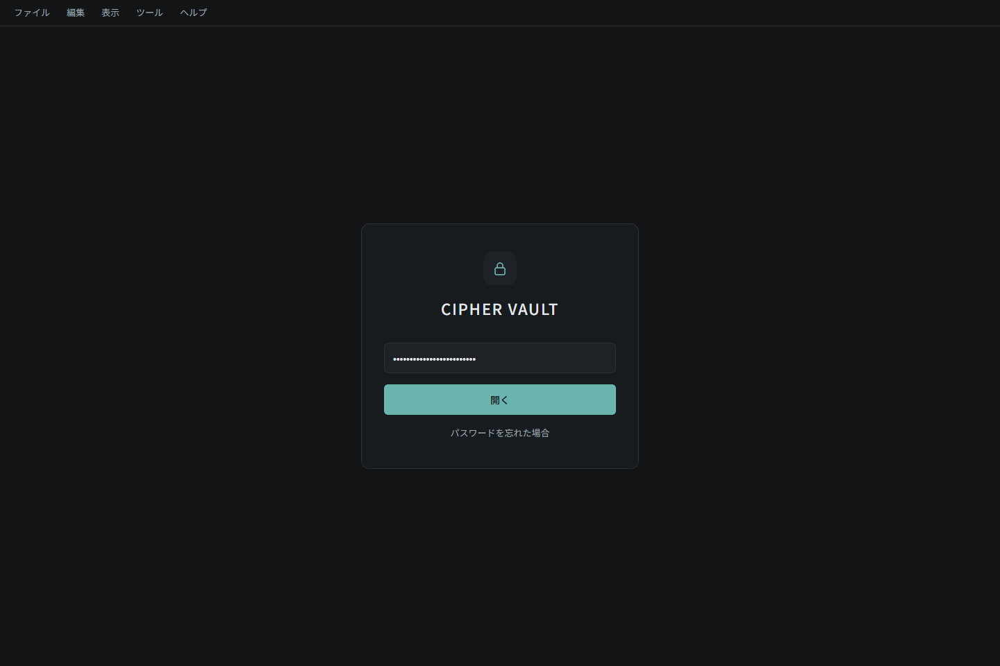
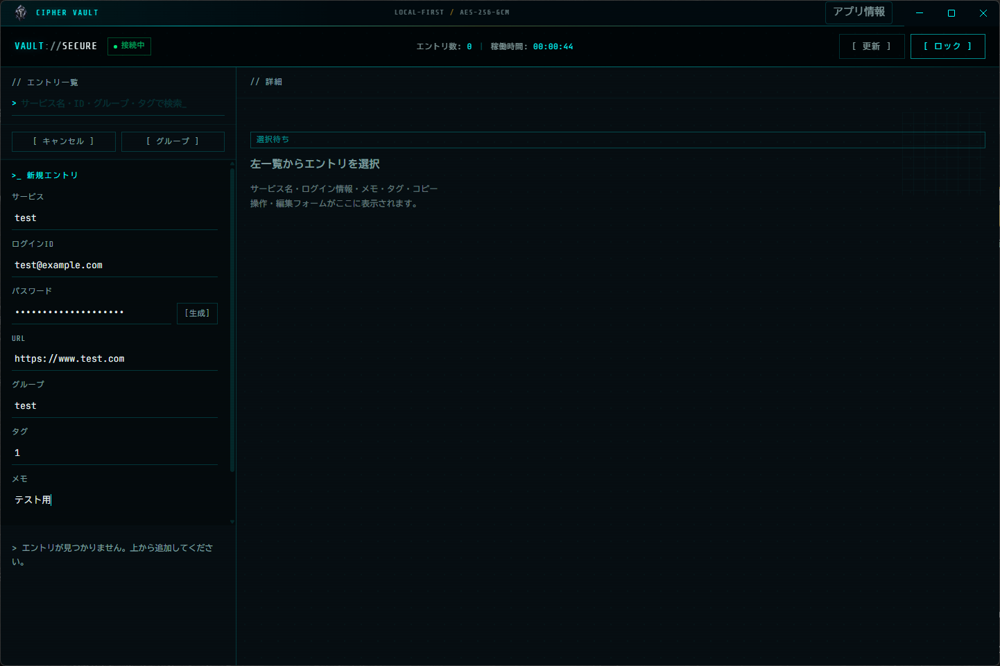
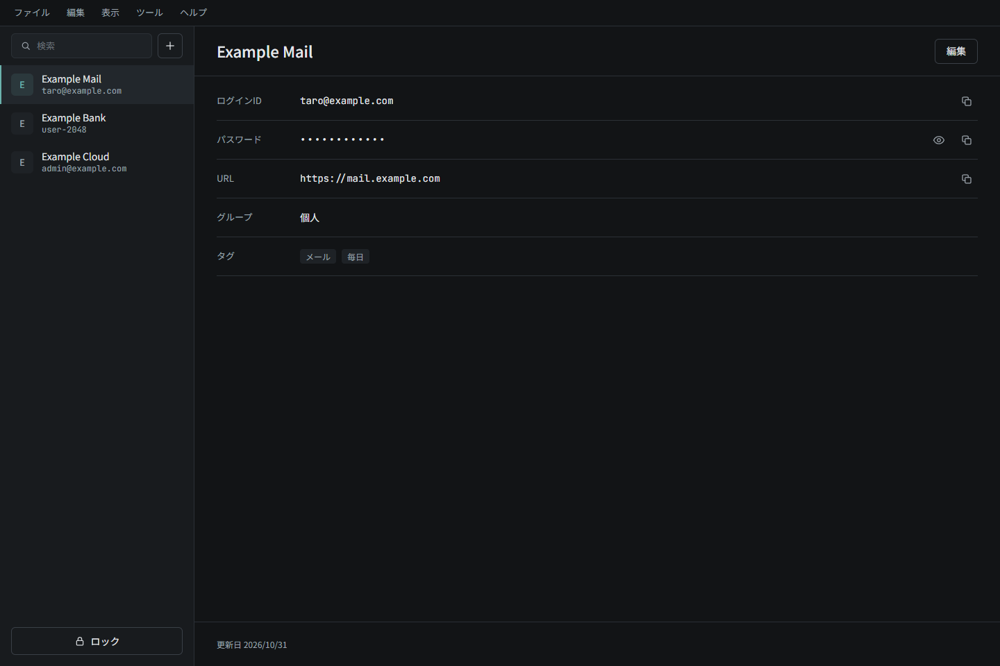

# CIPHER VAULT

端末内でパスワードを管理するWindowsのデスクトップアプリです。保管庫データは自端末のSQLiteに保存し、外部へ送信しません。

v0.9.0からRust（Tauri）で動きます。v0.8.0まではElectron版でした。v0.9.0までのWeb/API版は廃止しました。

保管庫は、サービス名・ログインID・パスワード・メモ・URL・タグ・グループ・日時・アイコンを含む全項目をAES-256-GCMで暗号化して保存します。v1.0.1までの従来形式（パスワードとメモだけを暗号化する形式）は、v1.1.0から開けません（[v1.0.1以前の保管庫](#v101以前の保管庫)）。

GitHubに接続するのは、手動で更新を確認・ダウンロードするときです。画面のフォントはライセンスとともに同梱しているので、フォントの読み込みで外部と通信しません。

## 入手・起動

Windows用の実行ファイルは [GitHub Releases](https://github.com/Termnix-IT/CIPHER-VAULT/releases) から入手します。配布版の利用にNode.jsやnpmのインストールは不要です。

| 配布形式 | 起動方法・用途 |
|---|---|
| `CIPHER-VAULT-<version>-x64-setup.exe` | インストールして利用する通常向けの版。アプリ内から手動更新できます |
| `CIPHER-VAULT-<version>-x64-portable.exe` | インストールせず実行する版。更新は配布ページから入手します |

どちらも保管庫は `%APPDATA%\CIPHER VAULT\data` に保存します。v0.8.0までのElectron版と同じ場所なので、Rust版へ切り替えても同じ保管庫を開きます。portable版もexeの隣には保存しないため、exeを移動しても保管庫データは移りません。別端末への移行には[暗号化バックアップ](#暗号化バックアップと復元)を使います。

画面の表示にはMicrosoft Edge WebView2を使います。Windows 11には標準で入っています。入っていない環境では、setupはWebView2をインストールしますが、portable版はインストールしないので事前に入れてください。

配布物はコード署名していないため、起動時に「WindowsによってPCが保護されました」と表示されることがあります。[GitHub Releases](https://github.com/Termnix-IT/CIPHER-VAULT/releases)から入手したファイルであることを確かめてから、「詳細情報」→「実行」で起動してください。

ソースコードからの起動は[開発する場合](#開発する場合)を参照してください。

## 主な機能

- マスターパスワードによる保管庫の作成・解除・ロック
- ログインの登録、編集、削除。APIキー・クレジットカード・銀行/証券も種類別に登録
- サービス名・ログインID・グループ・タグの検索とグループ表示。v0.6.0以降はグループの一括作成と右クリックでの追加・削除
- パスワード生成とログインID・パスワード・URLのコピー
- 共通サービス側で強制する、5分間操作がない場合の自動ロック
- 全項目を暗号化した `.cvault` バックアップと空の保管庫への復元（v0.2.2以降）
- ログインのパスワードの弱さ・使い回しなどを端末内で調べるパスワードの点検（v0.2.2以降）
- setup版での手動アップデート
- 「表示」メニューからのシンプル・ルミナスのデザイン切り替え（v0.7.0以降）
- メニューの列を兼ねた1段のタイトルバー（v1.0.0以降）。メニューはアイコンだけで、名前はツールチップで表示
- 一覧の幅の調整と、アイコンだけの表示への折りたたみ
- 項目ごとのアイコン（文字・SVG・画像と16色）。項目と一緒に暗号化して保存
- ログインIDのドラッグ＆ドロップ（パスワードは対象外）

## 基本操作と画面

以下の画像はデスクトップ版の画面です。表示している値はすべてテスト用です。左に一覧、右に詳細を表示し、「編集」で入力欄に切り替えます。バックアップとパスワードの点検は「ツール」から開きます。

### 1. 保管庫を設定・解除する

初回起動時は、12文字以上のマスターパスワードを2回入力し、「保管庫を作成」を押します。次回以降は同じパスワードを入力し、「開く」を押します。

マスターパスワードは復元できません。保管庫を空にするにも、今のマスターパスワードが必要です（[マスターパスワードを忘れた場合](#マスターパスワードを忘れた場合)）。



### 2. 項目を登録する

1. 左上の検索欄の横にある「＋」を押します。
2. 上部のタブで「ログイン」「APIキー」「カード」「銀行/証券」を選びます。ログインはサービス・ログインID・パスワードが必須で、URLは任意です。
3. グループ・タグ・メモを付ける場合は「＋ グループ・タグ・メモを追加」を押します。タグはカンマで区切ります。
4. ログインと銀行/証券のログインパスワードの「生成」を押すと、大文字・小文字・数字・記号を含む20文字のパスワードが入力されます。
5. 右下の「保存」を押します。

保存済みの種類は変更できません。

| 種類 | 必須項目 | 任意項目 |
|---|---|---|
| APIキー | 名前、キー | キーID、有効期限、URL、グループ、タグ、メモ |
| カード | 名前、カード番号 | 名義、有効期限（月）、セキュリティコード（3〜4桁）、URL、グループ、タグ、メモ |
| 銀行/証券 | 名前、ログインID、ログインパスワード | 取引パスワード、名前を付けた追加の秘密（第2暗証番号など、最大8件）、URL、グループ、タグ、メモ |

キーは空白を含めてそのまま保存します。カード番号は空白・ハイフンを除いた12〜19桁で保存し、暗証番号は扱いません。一覧にはカード番号の末尾4桁だけを表示します。

キー・カード番号・セキュリティコード・銀行/証券の各パスワードと追加の秘密は伏せ字で表示し、目のアイコンを2回押すと表示します。それぞれ個別にコピーできます。これらの秘密値と銀行/証券のログインIDは検索対象に含めず、ログインIDは一覧にも表示しません。

銀行/証券を保存した保管庫はv0.5.0以前のアプリでは開けなくなり、元に戻せません。



### 3. 詳細を確認・編集する

左の一覧から項目を選ぶと、右側に詳細を表示します。種類と更新日は名前の下に表示し、値が空の欄は表示しません。ログインID・パスワード・URLは各コピーボタンでクリップボードへコピーできます。

パスワードは伏せ字で表示します。目のアイコンを3秒以内に2回クリックすると表示し、表示中は1回クリックで隠します。キーボードでは、アイコンを選択してEnterまたはSpaceを2回押します。保存・生成・閲覧と編集の切り替え・項目の切り替え・ロックのときは伏せ字に戻ります。

右上の「編集」、またはメニューの「編集」→「選択中の項目を編集」で入力欄に切り替えます。欄の位置は閲覧時と同じです。

- 「保存」は変更を保存して閲覧に戻ります。保存・キャンセルは右下に固定し、入力欄が収まらないときは詳細部分をスクロールします。
- 「キャンセル」は、未保存の変更があれば破棄を確認してから閲覧に戻ります。
- 「生成」は入力欄のパスワードを置き換えます。保存前に内容を確認してください。
- 削除は、右上の「編集」の隣にある赤い「削除」か、編集中の左下の「削除」から行います。



### 4. 検索・グループ表示・ロック

- 左上の検索欄で、サービス名・ログインID・グループ・タグを絞り込めます。検索中は検索欄に「該当件数 / 全件数」を表示します。
- 検索欄の下のボタンで「ログイン」「APIキー」「カード」「銀行/証券」に絞り込めます。2種類以上を保存しているときだけ表示します。
- 件数の横で「名前順／更新順」を切り替えます。名前順は頭文字（英字、「あ行」などのかな行、漢字、数字・記号は「#」）ごと、更新順は「24時間以内」「7日以内」などの期間ごとに見出しを付けます。見出しはスクロールしても上に残ります。
- 「表示」→「すべて／グループ別」で表示を切り替え、グループ名で折りたたみます。
- 検索欄の横のフォルダのアイコンで、グループ名と対象の項目を指定して新しいグループを作ります。項目は1件以上必要で、既存と同じ名前を入力するとそのグループへ追加します。1つの項目が入れるグループは1つで、別のグループの項目を選ぶと移動します。項目がなくなったグループは自動で消えます。
- 一覧の項目を右クリック（またはメニューキー）すると「グループへ追加」「グループから削除」「項目削除」を選べます。右クリックでは選択中の項目は変わりません。
- 「ファイル」→「一覧を更新」で一覧を読み直します。アプリの更新は「ヘルプ」→「バージョンと更新」から行います。
- 作業を終えるときは「ファイル」→「ロック」を選びます。未保存の変更があれば破棄の確認を表示します。5分間操作がない場合も自動ロックされるため、入力中の内容は保存してください。OSの画面ロック・スリープ・復帰通知でもロックし、保管庫の再解除が必要です。
- コピーした内容は30秒後、または保管庫ロック時に自分のコピーと一致すれば消去します。後から別の内容をコピーした場合は保持します。コピーした内容はクリップボード履歴・クラウド同期に残さない指定で書き込みますが、OSや他のアプリが保存した過去のコピーの消去は保証しません。[動作条件](docs/設計.md#osイベントとクリップボード)を参照してください。

自動ロックは画面のタイマーではなく、保管庫を扱う共通サービス側で実行します。一覧の再取得や状態確認だけでは期限を延長しません。ウィンドウを閉じた場合や画面のプロセスが失われた場合もロックします。画面は状態確認でロックを反映し、状態を確認できない場合は表示中の秘密を消して再解除を求めます。

## 暗号化バックアップと復元

バックアップにはサービス名・ログインIDを含む全項目が暗号化されて入ります。マスターパスワードは含まれず、読み込みには書き出し時のバックアップ用パスワードが必要です。編集中の場合は保存してから「バックアップ」を開きます。

### 書き出す

1. 保管庫を解除し、「ツール」→「バックアップ」を選びます。
2. 「書き出す」タブで、バックアップ用パスワード（12文字以上）を2回入力します。
3. 「N件を書き出す」を押し、保存先に `.cvault` ファイルがあることを確認します。
4. ファイルとバックアップ用パスワードは別々の安全な場所に保管します。

### 読み込む（復元する）

1. 復元先でマスターパスワードを設定して保管庫を解除します。読み込めるのは項目が0件の保管庫だけです。
2. 「ツール」→「バックアップ」を開き、「読み込む」タブで `.cvault` ファイルを選びます。
3. 書き出し時のバックアップ用パスワードを入力し、「読み込む」を押します。
4. 読み込んだ項目を確認します。その後の解除には復元先のマスターパスワードを使います。

バックアップの形式の版は中身で決まり、ログインだけならv1、APIキー・カードを含むとv2、銀行/証券を含むとv3、アイコンを設定した項目を含むとv4です。版に未対応の旧版アプリでは読み込めず、v4はv1.0.1以前では読み込めません。このアプリはv1〜v4のどれも復元できます。

既存データへの追加・置き換えは行いません。バックアップは10,000件・暗号化前の内容11 MiB、読込ファイル16 MiBまで対応します。形式と互換性は[設計](docs/設計.md)を参照してください。

## マスターパスワードの変更・空にする

1. 保管庫を解除し、編集中の内容を保存してから「ツール」を開きます。
2. 「マスターパスワードを変更…」または「保管庫を空にする…」を選びます。
3. 今のマスターパスワード、新しいマスターパスワード（2回）、復旧用パスワード（2回）を入力します。新しいマスターパスワードと復旧用パスワードは12文字以上です。復旧用パスワードは、変更が途中で止まったときに元に戻すために使います。保管庫を空にする場合は確認欄も選択します。
4. 照合と切替が完了したら画面を閉じ、新しいマスターパスワードで解除します。解除後は[暗号化バックアップ](#暗号化バックアップと復元)を端末外にも書き出してください。

マスターパスワードの変更では、全項目を新しい鍵で暗号化し直します。保管庫を空にする操作は、新しい鍵の空の保管庫へ切り替えるだけで、安全な消去ではありません。元の保管庫と復旧用ファイルは端末内に残り、以前のパスワードで復号できます。

処理を止めるときは「中止」を押し、安全に停止するまで待ってください。切り替えが途中で止まった場合は「前回の変更を完了させてください」の画面が自動で開き、通常の解除と編集はできなくなります。変更前と変更時に決めたマスターパスワード、復旧用パスワードを入力して「完了させる」を押してください。**元のファイルを削除・置換して回避しないでください。**Windowsの電源断時の永続化など、残る条件は[設計](docs/設計.md#保管庫の管理サービスと復旧専用起動)を参照してください。

## パスワードの点検

保存後に「ツール」→「パスワードの点検」を開くと、ログインのパスワードを端末内で調べます。

| 区分 | 対象 |
|---|---|
| 直したほうがいい | 推測されやすいパスワード、使い回し |
| 余裕があれば見直す | 1年以上変更なし、URLなし、1年以上更新なし |

件数を押すと絞り込み、「開く」から対象を編集できます。変更後は「もう一度点検」を押します。

スコアは弱さと使い回しだけから出す目安で、古さ・URLなし・長期間更新なしは減点しません。「1年以上」は365日で判定し、旧データのパスワード変更日は不明として扱います。外部の漏えい情報には照会しないので、スコアは安全性を保証しません。判定の詳細は[設計](docs/設計.md)を参照してください。

## アプリを更新する

Windowsのsetup版では「ヘルプ」→「バージョンと更新」から確認・ダウンロードし、「再起動して更新」でインストーラーの操作なしに更新できます。OSの権限確認が出る場合があります。起動時の確認や通常終了時の自動適用はありません。その他の配布形式は配布ページから入手します。

Rust版はダウンロードしたsetupの署名を確かめてから適用し、署名が合わない更新は適用しません。

v0.8.0以前のElectron版からは、配布ページからv0.9.0以降のsetupを入手して実行します。setupはインストールの前にElectron版をアンインストールし、保管庫は残すので、Rust版が同じ保管庫を開きます。Electron版が起動していると終了を求める確認が出るため、編集中の内容を保存して終了してください。Electron版のportable版は登録されていないので自動では削除されません。不要になったら削除してください。詳しくは[手動更新とアイコン](docs/手動更新とアイコン.md)を参照してください。

### v1.0.1以前の保管庫

v1.1.0で保管庫の形式を整理し、v1.0.1以前の版との互換をやめました。

- v0.3.0以降の新形式（v2）の保管庫は、そのまま開けます。v1.0.1までのアイコンは、更新後の最初の解除で各項目へ移します。そのときに保管庫を同じフォルダの `before-v4.sqlite` へ複製するので、旧版に戻す必要があるときは、この複製を使えます。
- アイコンを設定した項目がある保管庫は、v1.0.1以前の版では開けません。Electron版（v0.8.0以前）も同じです。
- 従来形式の保管庫（ロック画面に「以前の形式の保管庫が見つかりました」と表示される場合）は開けません。v1.0.1までの版で[暗号化バックアップ](#暗号化バックアップと復元)を書き出し、この版で新しい保管庫を作成してから復元してください。従来形式のファイルは削除せずに残します。

## マスターパスワードを忘れた場合

マスターパスワードを復旧する手段はありません。「保管庫を空にする…」も今のマスターパスワードで解除してから使う操作です。

事前に書き出した `.cvault` とそのバックアップ用パスワードがある場合は、新しいマスターパスワードを設定した空の保管庫へバックアップ時点の内容を読み込めます。

## 開発する場合

開発にはWindows、Node.js 22.12.0以上とnpm、Rust（stable）とMSVCのビルドツールを使用します。リポジトリルートで実行します。

```powershell
npm install
npm run build:web
New-Item -ItemType Directory -Force "$env:TEMP\cipher-vault-rust-data"
$env:CIPHER_VAULT_DATA_DIR = "$env:TEMP\cipher-vault-rust-data"
cargo run -p cipher-vault
```

`CIPHER_VAULT_DATA_DIR` には必ず試験用のフォルダを指定してください。指定しないと、この端末で使っている保管庫を開きます。

| コマンド | 用途 |
|---|---|
| `npm run build:web` | 画面をビルド（アプリが埋め込む `apps/web/dist-tauri`） |
| `npm run build:tauri` | 画面とアプリのreleaseビルド |
| `npm run package:tauri` | `dist-tauri/` にWindows用setup・portableを生成（公開しない） |

検証コマンドは[変更に応じた検証](docs/開発・配布手順.md#変更に応じた検証)から選びます。開発・テストで利用中の保管庫を初期化・上書きしないでください。構成・暗号化は[設計](docs/設計.md)、保存先・配布・CIは[開発・配布手順](docs/開発・配布手順.md)を参照してください。

## 関連ドキュメント

| 文書 | 内容 |
|---|---|
| [ドキュメント一覧](docs/README.md) | 文書の索引と公開・非公開の管理基準 |
| [設計](docs/設計.md) | アーキテクチャ、データ、暗号化、画面から呼べるコマンド |
| [開発・配布手順](docs/開発・配布手順.md) | 開発起動、ビルド、保存先、パッケージ化 |
| [手動更新とアイコン](docs/手動更新とアイコン.md) | 更新操作、旧版からの移行、アイコン生成 |
| [リリース手順](docs/リリース手順.md) | GitHub Releasesへの公開 |
| [リリースノート](docs/リリースノート/) | バージョンごとの変更内容と互換性 |
| [ワークフロー](docs/ワークフロー/) | 主要処理のMermaid図 |
