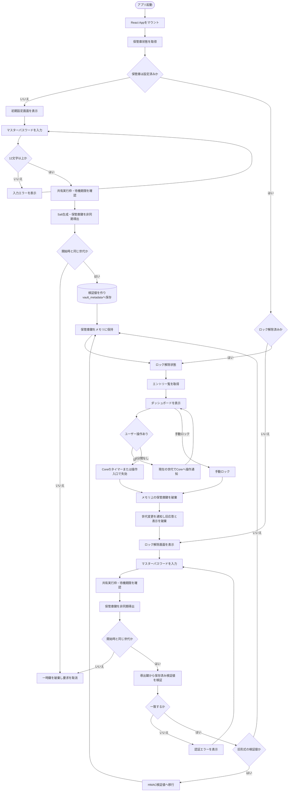

# 1. 起動・初期設定・ロック解除

従来形式の初期設定・解除と自動ロックの流れです。新形式・中断後の復旧は[保管庫の管理サービス](../設計.md#保管庫の管理サービスと復旧専用起動)を参照してください。

## 状態に関する注意

設定情報はDB、解除状態・鍵・世代・5分の期限は `VaultSession` が保持します。通常APIや状態確認では期限を延長せず、期限後の操作通知でも再解除しません。再起動・対応するOS通知・ウィンドウ終了・renderer喪失でロックし、自動解除は行いません。

初期設定・解除の同時実行、認証失敗時の待機、導出中の取消は[マスターパスワード](../設計.md#マスターパスワード)を参照してください。旧検証値の移行は認証成功後だけ行い、移行後の旧版利用と既存DBコピーの制約は[v0.2.1の修正](../リリースノート/v0.2.1.md)に記載しています。
