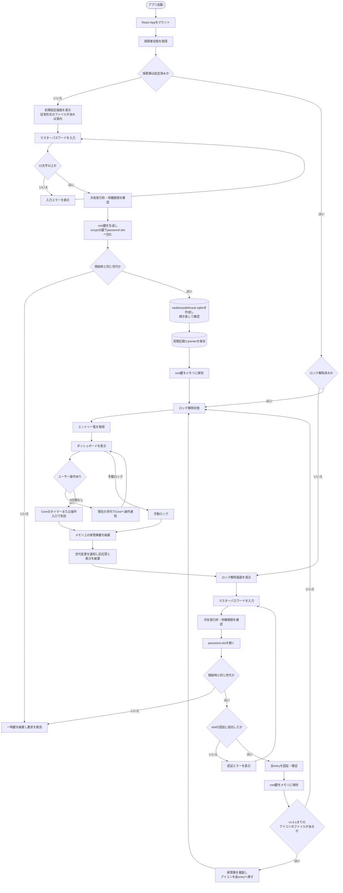

# 1. 起動・初期設定・ロック解除

初期設定・解除と自動ロックの流れです。鍵更新・中断後の復旧は[保管庫の管理サービス](../設計.md#保管庫の管理サービスと復旧専用起動)を参照してください。

## 状態に関する注意

password slotはDB、解除状態・鍵・世代・5分の期限は中核のセッション（`crates/vault-core/src/session.rs`）が保持します。通常APIや状態確認では期限を延長せず、期限後の操作通知でも再解除しません。再起動・画面ロックやスリープの通知・ウィンドウ終了・画面のプロセス喪失でロックし、自動解除は行いません。

初期設定・解除の同時実行、認証失敗時の待機、導出中の取消は[マスターパスワード](../設計.md#マスターパスワード)、作成と保管庫の選択は[新規作成と保管庫の選択](../設計.md#新規作成と保管庫の選択)、アイコンの取り込みは[一覧のアイコン](../設計.md#一覧のアイコン)を参照してください。
