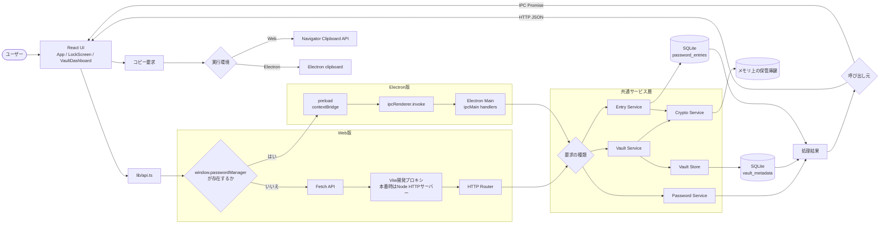

# 2. Web・ElectronからSQLiteまで

WebはHTTP、ElectronはIPCを経由し、同じサービス層を使います。図のDB名は従来形式です。新形式は[通常起動とv2サービス](../設計.md#通常起動とv2サービス)を参照してください。

## 実行経路の違い

| 項目 | Web版 | Electron版 |
|---|---|---|
| 通信 | HTTP/JSON | preload経由のIPC |
| 入口 | `apps/api/src/routes/router.ts` | `apps/electron/src/desktop-main.ts` のIPC handler |
| サービス層 | APIサービスを使用 | 同じAPIサービスを直接import |
| 開発時の画面 | Vite `http://localhost:5173` | Viteを検出して読み込み |
| 配布時の画面 | APIが静的ファイルを配信 | `apps/web/dist/index.html` を読み込み |
| DB保存先 | 通常は `apps/api/data` | Electron `userData/data` |

## 境界と責務

`lib/api.ts` がHTTPとIPCを切り替え、共通サービスが入力検証・ロック判定・暗号・DB操作を担当します。共通型は `packages/shared/src/types.ts` です。DBは起動時に形式を検査して開き、終了時にロックして閉じます。

具体的な境界は[画面のsandboxとCSP](../設計.md#画面のsandboxとcsp)、[入力検証](../設計.md#入力の検証と上限)、[DBの接続](../設計.md#dbの接続と形式判定)を参照してください。
