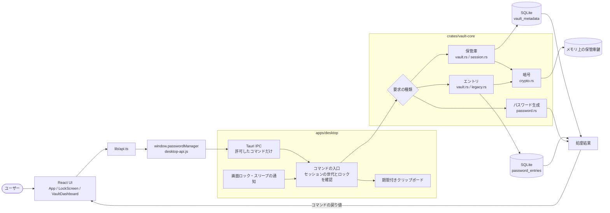

# 2. 画面からSQLiteまで

画面は `window.passwordManager` からTauriのコマンドを呼び、Rustの中核が保管庫を扱います。図のDB名は従来形式です。新形式は[通常起動とv2サービス](../設計.md#通常起動とv2サービス)を参照してください。

## 境界と責務

`lib/api.ts` は `window.passwordManager` を呼ぶだけで、保管庫の処理を持ちません。デスクトップ（`apps/desktop`）がコマンドの入口でセッションの世代とロック・OS状態を確認し、中核（`crates/vault-core`）が入力検証・ロック判定・暗号・DB操作を担当します。画面が使う共通型は `packages/shared/src/types.ts` です。DBは起動時に形式を検査して開き、終了時にロックして閉じます。

具体的な境界は[画面とCSP](../設計.md#画面とcsp)、[画面から呼べるコマンド](../設計.md#画面から呼べるコマンド)、[入力検証](../設計.md#入力の検証と上限)、[DBの接続](../設計.md#dbの接続と形式判定)を参照してください。
