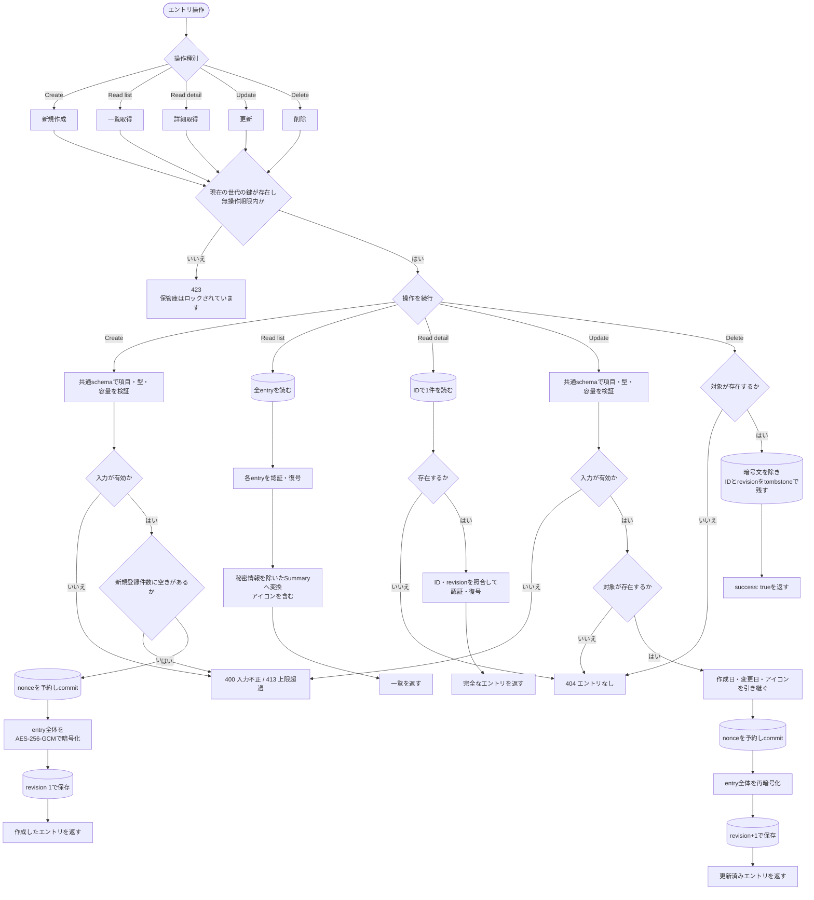
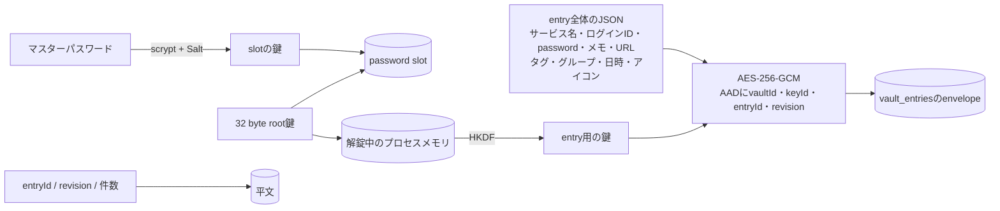

# 3. エントリCRUDと暗号化

エントリのCRUDと暗号化の流れです。entryは種類によらず全体を1つの暗号envelopeにします。詳しくは[種類別エントリ](../設計.md#種類別エントリ)と[v2サービス](../設計.md#通常起動とv2サービス)を参照してください。

入力契約と数値上限は[設計](../設計.md#入力の検証と上限)にまとめています。編集上限を超える既存値も閲覧でき、拒否された更新で元の値を切り詰めることはありません。

## 保存データの暗号化範囲

## セキュリティ境界

CRUDの入口と結果返却前に、解除状態・期限・世代を検査します。ロック後の要求や古い応答は拒否し、一覧には秘密値を含めません。

実装は `crates/vault-core` の `v2.rs` と `crypto.rs`、暗号形式は[v2の暗号形式](../設計.md#v2の暗号形式)、保存形式と版は[v2保存層](../設計.md#v2保存層)を参照してください。
