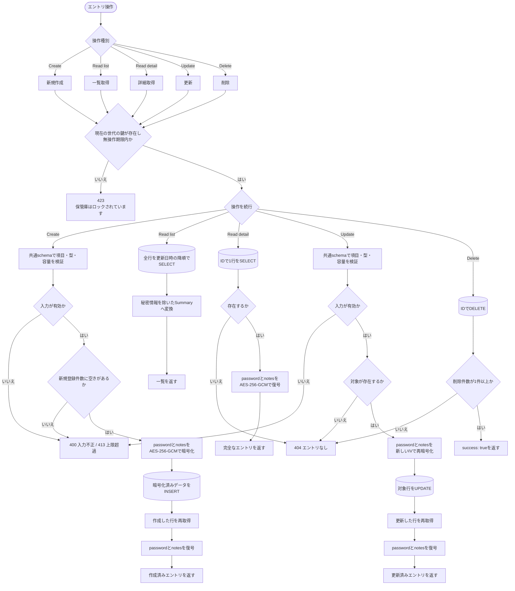
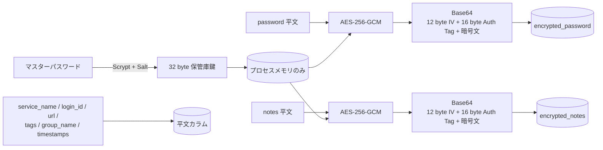

# 3. エントリCRUDと暗号化

従来形式のログインを対象に、CRUDと暗号化の流れを示します。新形式は全項目を暗号化します。[種類別エントリ](../設計.md#種類別エントリ)と[v2サービス](../設計.md#通常起動とv2サービス)を参照してください。

入力契約と数値上限は[設計](../設計.md#入力の検証と上限)にまとめています。編集上限を超える既存値も閲覧でき、拒否された更新で元の値を切り詰めることはありません。

## 保存データの暗号化範囲

## セキュリティ境界

CRUDの入口と結果返却前に、解除状態・期限・世代を検査します。ロック後の要求や古い応答は拒否し、一覧には秘密値を含めません。

従来形式の暗号化範囲・IV・認証タグは上図のとおりです。実装は `entry-service.ts` と `crypto-service.ts`、保存形式と互換性は[エントリ暗号化](../設計.md#エントリ暗号化)を参照してください。
